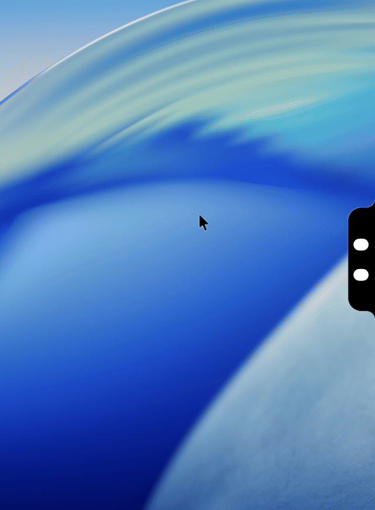

# Agent Notch Plus

Agent Notch Plus puts Claude, Codex, and Grok usage in the Mac notch.

<p align="center">
  
</p>

[Agent Notch Plus](https://github.com/neeeeeeessa/agent-notch-plus) is developed by [Vanessa Simões](https://x.com/enchantedcode). Forked from [Agent Notch](https://github.com/itslucadev/AgentNotch) by Luca Becker.

## What it does

The circles sit on the edge of the screen. Hover one for its detail card. Click one to refresh that circle only.

You can put the notch on the right, left, top, or bottom edge. It can stay open, collapse to a pill that opens when you reach it, or stay hidden. The app icon can live in the Dock, in the menu bar, or nowhere.

The app does not create an account. Claude uses the sign-in Claude Code already saved. Codex uses the sign-in Codex already saved. Grok uses the sign-in the Grok CLI already saved.

## Changes from Agent Notch

Agent Notch's third circle is Cursor, and its rings turn green, yellow, and red as a limit fills. This fork changes that, and a few behaviors around it.

- The circles are Claude, Codex, and Grok. Cursor is a row on the Grok card. That card is one weekly allowance shared by Grok Build, Grok Bot, and Cursor, with the per-product split the server reports.
- Each provider has a fixed color. The color stays put as usage rises.
- Usage access starts off. You turn it on for each provider. A token goes only to that provider's usage host. The app never refreshes a token itself. When the Grok sign-in expires, it asks the Grok CLI to renew its own sign-in.
- After a restart, each circle shows its last reading, dimmed and dated, until a new one arrives. When Claude Code's or Codex's sign-in has expired, the card says the numbers update when you next use that tool.
- When a usage endpoint rate-limits, the last good reading stays bright through the cooldown.
- A click refreshes only the circle you hit.
- The mascot stays still while you are away.
- Downloads from this fork's Releases update themselves from this fork's own feed. Builds you make yourself in Xcode do not check for updates.

## Requirements

macOS 26 or later, and Xcode to build. Sign in to Claude Code, Codex, or the Grok CLI before you expect live numbers. Download the latest signed and notarized build from [Releases](https://github.com/neeeeeeessa/agent-notch-plus/releases); it keeps itself up to date.

## Build

```bash
git clone https://github.com/neeeeeeessa/agent-notch-plus.git
cd agent-notch-plus
open AgentNotch.xcodeproj
```

Select the AgentNotch target, open Signing & Capabilities, and choose your own Team.

Then use Product, Run.

A local build that skips team signing:

```bash
xcodebuild -project AgentNotch.xcodeproj -scheme AgentNotch -configuration Debug -destination 'platform=macOS' CODE_SIGN_IDENTITY=- DEVELOPMENT_TEAM= build
```

Xcode prints the path of `AgentNotch.app` near the end of that log.

## First launch

A new install starts with usage access off. Nothing is read until you turn a switch on.

Open Settings from the menu bar icon, or from the Dock icon if you left the app there.

- Claude asks macOS for permission to read the Claude Code keychain item.
- Codex reads `~/.codex/auth.json` when that file is readable. Otherwise it asks for the Codex Auth keychain item.
- Grok reads `~/.grok/auth.json`. Sign in with the Grok CLI before you turn that switch on.

## Releasing

Maintainers publish a signed, notarized build with `Scripts/release.sh v1.2`. The script lists its one-time setup at the top. The signing certificate, notary credentials and update key stay in the maintainer's keychain, and the team ID lives in an uncommitted `.env`.
